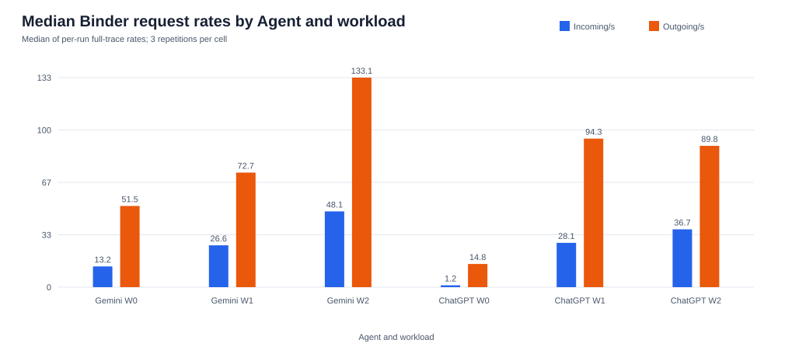
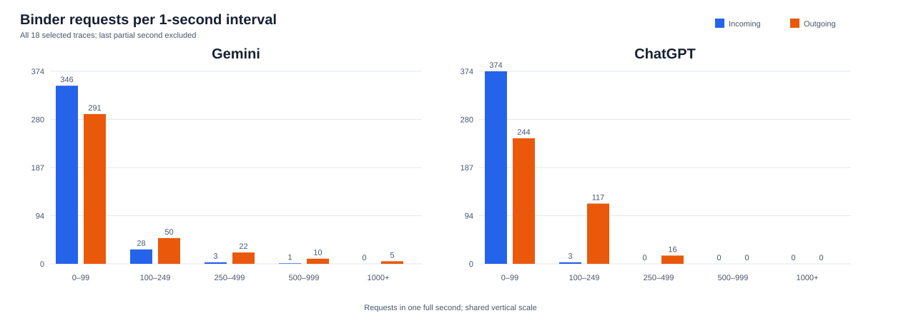
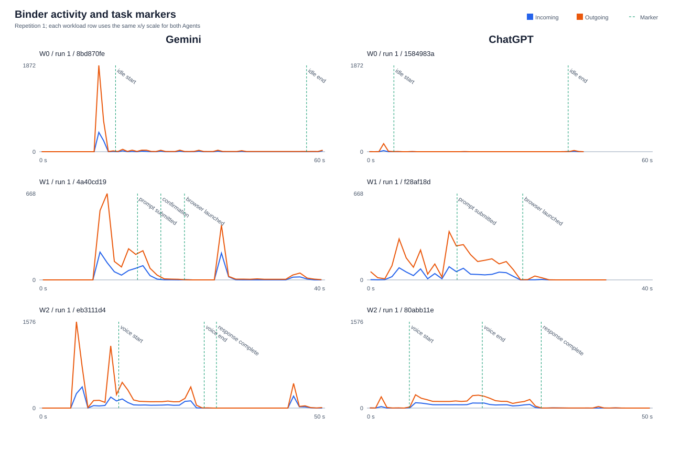
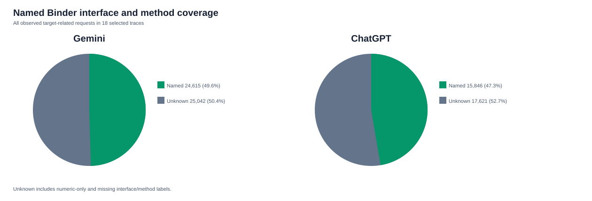

# Metrics 1–3: observed Binder communication (Gemini, ChatGPT)

Across these traces: **83,124 target-related requests**, **40,461 named interface/method requests**, **42,663 unidentified API requests**, and **3,601 structural two-hop candidates** (1,070 with both hops in the task window). Counts across runs are observations, not distinct user actions.

| Observed quantity | Gemini | ChatGPT |
| --- | --- | --- |
| Runs | 9 | 9 |
| Incoming requests | 10,402 | 8,753 |
| Outgoing requests | 32,182 | 24,714 |
| Internal requests | 7,073 | 0 |
| Named API requests | 24,615 | 15,846 |
| Unidentified API requests | 25,042 | 17,621 |
| Two-hop candidates | 2,281 | 1,320 |
| Both hops in task window | 662 | 408 |

ChatGPT’s zero internal Binder request count is consistent with the collected traces. Across all nine selected runs, only one identifiable target process, com.openai.chatgpt, was observed. Rechecking the raw traces found no additional processes with the same UID or a matching ChatGPT package name, and no Binder requests with both endpoints belonging to that UID.

Gemini, in contrast, was analyzed through the Google App package, which included multiple processes such as :search and :interactor. Requests between these processes were classified as internal. Of Gemini’s 7,073 internal requests, 6,962—approximately 98.4%—occurred during voice workloads.

This difference primarily reflects the observed process organization and the chosen attribution boundaries. Internal function calls and thread coordination within a single process may not generate kernel-level Binder transactions. Therefore, the result should be reported as “no internal Binder requests were observed within ChatGPT’s identified target process set,” rather than evidence that ChatGPT performs no internal communication. Gemini’s broader Google App process scope and potentially unattributed isolated processes remain limitations of the comparison.

## Metric 1 — Communication structure

Peer count is the number of distinct resolved peer processes within each trace. The full [peer identity table](peers.csv) keeps trace-specific UPID/PID, UID, available package mappings and unresolved labels. [Directed edges](directed_edges.csv) preserve sender → receiver and the request count for every run. Incoming and outgoing count requests from the target's perspective; internal requests between target processes are separate. Replies are not counted as new requests.

| Workload / rep | Gemini | ChatGPT |
| --- | --- | --- |
| W0 / 1 | `8bd870fe` Peers 12 · edges 26 In 789 · out 3,086 · internal 8 | `1584983a` Peers 6 · edges 10 In 43 · out 240 · internal 0 |
| W0 / 2 | `db3b4a43` Peers 12 · edges 33 In 995 · out 3,720 · internal 12 | `65f27b9a` Peers 6 · edges 10 In 119 · out 660 · internal 0 |
| W0 / 3 | `5bf78800` Peers 9 · edges 13 In 427 · out 1,086 · internal 0 | `684c04da` Peers 6 · edges 9 In 52 · out 671 · internal 0 |
| W1 / 1 | `4a40cd19` Peers 10 · edges 22 In 1,047 · out 2,868 · internal 25 | `f28af18d` Peers 7 · edges 11 In 943 · out 3,162 · internal 0 |
| W1 / 2 | `08f1dc71` Peers 9 · edges 26 In 914 · out 2,848 · internal 33 | `51b898e5` Peers 6 · edges 10 In 933 · out 3,397 · internal 0 |
| W1 / 3 | `e7366222` Peers 15 · edges 38 In 880 · out 3,063 · internal 33 | `bc99d552` Peers 6 · edges 10 In 606 · out 1,735 · internal 0 |
| W2 / 1 | `eb3111d4` Peers 21 · edges 40 In 2,404 · out 7,162 · internal 2,241 | `80abb11e` Peers 9 · edges 14 In 1,476 · out 3,476 · internal 0 |
| W2 / 2 | `44b901eb` Peers 21 · edges 40 In 1,474 · out 4,276 · internal 2,319 | `1aca5372` Peers 9 · edges 14 In 2,664 · out 6,688 · internal 0 |
| W2 / 3 | `abe56051` Peers 17 · edges 41 In 1,472 · out 4,073 · internal 2,402 | `c3823f8c` Peers 9 · edges 14 In 1,917 · out 4,685 · internal 0 |

Most frequent peer process names within each Agent (a name can represent different trace-specific processes):

| Rank | Gemini | ChatGPT |
| --- | --- | --- |
| 1 | system_server · 17,377 | /system/bin/surfaceflinger · 28,261 |
| 2 | /system/bin/surfaceflinger · 16,027 | system_server · 3,950 |
| 3 | com.google.android.gms · 4,425 | /system/bin/keystore2 · 768 |
| 4 | media.swcodec · 1,539 | com.sohu.inputmethod.sogouoem · 154 |
| 5 | media.extractor · 720 | com.android.vending · 130 |

Most frequent directed process-name pairs within each Agent (full per-run identifiers and weights are in `directed_edges.csv`):

| Rank | Gemini | ChatGPT |
| --- | --- | --- |
| 1 | com.google.android.googlequicksearchbox:search → system_server · 14,238 | com.openai.chatgpt → /system/bin/surfaceflinger · 20,135 |
| 2 | com.google.android.googlequicksearchbox:search → /system/bin/surfaceflinger · 11,382 | /system/bin/surfaceflinger → com.openai.chatgpt · 8,126 |
| 3 | /system/bin/surfaceflinger → com.google.android.googlequicksearchbox:search · 4,645 | com.openai.chatgpt → system_server · 3,481 |
| 4 | com.google.android.googlequicksearchbox:interactor → com.google.android.googlequicksearchbox:search · 4,563 | com.openai.chatgpt → /system/bin/keystore2 · 768 |
| 5 | com.google.android.googlequicksearchbox:search → com.google.android.googlequicksearchbox:interactor · 2,490 | system_server → com.openai.chatgpt · 469 |
| 6 | com.google.android.googlequicksearchbox:search → com.google.android.gms · 2,218 | com.sohu.inputmethod.sogouoem → com.openai.chatgpt · 99 |
| 7 | system_server → com.google.android.googlequicksearchbox:search · 1,958 | com.openai.chatgpt → com.android.vending · 95 |
| 8 | com.google.android.gms → com.google.android.googlequicksearchbox:search · 1,727 | com.openai.chatgpt → /vendor/bin/hw/android.hardware.graphics.allocator-V2-service-mediatek · 74 |
| 9 | com.google.android.googlequicksearchbox:search → media.swcodec · 1,025 | com.openai.chatgpt → /system/bin/audioserver · 60 |
| 10 | media.extractor → com.google.android.googlequicksearchbox:search · 720 | com.openai.chatgpt → com.sohu.inputmethod.sogouoem · 55 |

## Metric 2 — Communication timing

Rates divide each run's incoming/outgoing request counts by its full trace duration. Latency uses only synchronous calls with a matched reply; the median and p95 are calculated per run and are not pooled. The [one-second timeline](timeline_1s.csv) contains incoming, outgoing and internal counts. Task marker times remain in each run's `summary.json`.

| Workload / rep | Gemini | ChatGPT |
| --- | --- | --- |
| W0 / 1 | `8bd870fe` Trace 59.9s · in 13.2/s · out 51.5/s Matched sync 2,604 · median 0.384ms · p95 4.985ms | `1584983a` Trace 45.5s · in 0.9/s · out 5.3/s Matched sync 142 · median 0.671ms · p95 10.518ms |
| W0 / 2 | `db3b4a43` Trace 47.9s · in 20.8/s · out 77.6/s Matched sync 3,139 · median 0.372ms · p95 5.382ms | `65f27b9a` Trace 44.7s · in 2.7/s · out 14.8/s Matched sync 323 · median 0.675ms · p95 9.580ms |
| W0 / 3 | `5bf78800` Trace 46.5s · in 9.2/s · out 23.4/s Matched sync 719 · median 0.373ms · p95 4.445ms | `684c04da` Trace 43.3s · in 1.2/s · out 15.5/s Matched sync 359 · median 0.718ms · p95 8.859ms |
| W1 / 1 | `4a40cd19` Trace 39.4s · in 26.6/s · out 72.7/s Matched sync 1,880 · median 0.356ms · p95 3.933ms | `f28af18d` Trace 33.5s · in 28.1/s · out 94.3/s Matched sync 570 · median 0.548ms · p95 9.328ms |
| W1 / 2 | `08f1dc71` Trace 43.0s · in 21.2/s · out 66.2/s Matched sync 1,351 · median 0.350ms · p95 3.890ms | `51b898e5` Trace 28.9s · in 32.3/s · out 117.4/s Matched sync 753 · median 0.513ms · p95 6.610ms |
| W1 / 3 | `e7366222` Trace 31.4s · in 28.0/s · out 97.5/s Matched sync 1,802 · median 0.269ms · p95 2.921ms | `bc99d552` Trace 25.1s · in 24.2/s · out 69.1/s Matched sync 427 · median 0.534ms · p95 6.595ms |
| W2 / 1 | `eb3111d4` Trace 49.9s · in 48.2/s · out 143.5/s Matched sync 4,681 · median 0.279ms · p95 3.768ms | `80abb11e` Trace 49.7s · in 29.7/s · out 69.9/s Matched sync 364 · median 0.530ms · p95 7.837ms |
| W2 / 2 | `44b901eb` Trace 34.5s · in 42.8/s · out 124.0/s Matched sync 2,189 · median 0.241ms · p95 3.265ms | `1aca5372` Trace 58.8s · in 45.3/s · out 113.8/s Matched sync 648 · median 0.480ms · p95 6.814ms |
| W2 / 3 | `abe56051` Trace 30.6s · in 48.1/s · out 133.1/s Matched sync 1,951 · median 0.256ms · p95 4.166ms | `c3823f8c` Trace 52.2s · in 36.7/s · out 89.8/s Matched sync 534 · median 0.483ms · p95 6.717ms |

Median rates across selected repetitions (these use the full trace, including setup and completion margins):

| Workload | Gemini | ChatGPT |
| --- | --- | --- |
| W0 | In 13.18/s · out 51.54/s | In 1.20/s · out 14.75/s |
| W1 | In 26.56/s · out 72.74/s | In 28.14/s · out 94.35/s |
| W2 | In 48.10/s · out 133.09/s | In 36.73/s · out 89.77/s |

This figure shows the distribution of Binder request counts across full one-second intervals in the 18 selected traces. The horizontal axis groups intervals by requests per second, while the vertical axis shows how many intervals fall into each range. Blue bars represent incoming requests, and orange bars represent outgoing requests. Both agents receive fewer than 100 requests per second in most intervals. ChatGPT has more intervals with 100–249 outgoing requests per second, whereas Gemini exhibits larger bursts, including five intervals with at least 1,000 outgoing requests per second. These distributions combine all workloads and exclude the final partial second of each trace, so they do not identify which tasks caused the bursts or establish that one agent is more efficient.

The timeline shows repetition 1 for each Agent/workload, chosen in advance. Gemini is left and ChatGPT right. The two panels in each workload row share both time and count scales; scales may differ across W0/W1/W2 rows. Green dashed lines are operator task markers. Inspect `timeline_1s.csv` and `summary.json` for exact values and marker timestamps. The five top peers for every run are in its `summary.json`; the full ranking is in `peers.csv`.

## Metric 3 — Interfaces and mediated paths

A request is counted as a named API only when both a Binder interface and a nonplaceholder method name are identified. Numeric-only (`#...`), `Unknown_Transaction_Code:...`, and missing method labels are grouped as unidentified. The complete [interface/API table](api_counts.csv) includes direction and separate unidentified counts. A transaction code alone does not uniquely identify an API; raw codes and endpoints remain in each run's `transactions.json` and `path_evidence.json`.

| Workload / rep | Gemini | ChatGPT |
| --- | --- | --- |
| W0 / 1 | `8bd870fe` Named API 2,626 · unidentified 1,257 Code/placeholder 652 · two-hop 239 · in window 24 | `1584983a` Named API 205 · unidentified 78 Code/placeholder 41 · two-hop 58 · in window 9 |
| W0 / 2 | `db3b4a43` Named API 3,175 · unidentified 1,552 Code/placeholder 848 · two-hop 305 · in window 33 | `65f27b9a` Named API 508 · unidentified 271 Code/placeholder 92 · two-hop 106 · in window 27 |
| W0 / 3 | `5bf78800` Named API 923 · unidentified 590 Code/placeholder 215 · two-hop 80 · in window 10 | `684c04da` Named API 582 · unidentified 141 Code/placeholder 100 · two-hop 109 · in window 51 |
| W1 / 1 | `4a40cd19` Named API 2,439 · unidentified 1,501 Code/placeholder 448 · two-hop 133 · in window 27 | `f28af18d` Named API 2,289 · unidentified 1,816 Code/placeholder 114 · two-hop 137 · in window 20 |
| W1 / 2 | `08f1dc71` Named API 2,245 · unidentified 1,550 Code/placeholder 311 · two-hop 105 · in window 20 | `51b898e5` Named API 2,433 · unidentified 1,897 Code/placeholder 164 · two-hop 192 · in window 48 |
| W1 / 3 | `e7366222` Named API 2,481 · unidentified 1,495 Code/placeholder 447 · two-hop 133 · in window 44 | `bc99d552` Named API 1,129 · unidentified 1,212 Code/placeholder 103 · two-hop 123 · in window 31 |
| W2 / 1 | `eb3111d4` Named API 5,139 · unidentified 6,668 Code/placeholder 3,325 · two-hop 562 · in window 194 | `80abb11e` Named API 2,015 · unidentified 2,937 Code/placeholder 65 · two-hop 160 · in window 114 |
| W2 / 2 | `44b901eb` Named API 2,842 · unidentified 5,227 Code/placeholder 2,574 · two-hop 374 · in window 133 | `1aca5372` Named API 3,971 · unidentified 5,381 Code/placeholder 129 · two-hop 231 · in window 55 |
| W2 / 3 | `abe56051` Named API 2,745 · unidentified 5,202 Code/placeholder 2,679 · two-hop 350 · in window 177 | `c3823f8c` Named API 2,714 · unidentified 3,888 Code/placeholder 116 · two-hop 204 · in window 53 |

Most frequent identified interface/method/direction groups:

| Rank | Gemini | ChatGPT |
| --- | --- | --- |
| 1 | IDisplayEventConnection.requestNextVsync (outgoing) · 6,136 | IDisplayEventConnection.requestNextVsync (outgoing) · 11,634 |
| 2 | IAppSearchManager.registerObserverCallback (outgoing) · 1,900 | IConnectivityManager.getNetworkCapabilities (outgoing) · 584 |
| 3 | IAppSearchManager.unregisterObserverCallback (outgoing) · 1,862 | IConnectivityManager.getAllNetworks (outgoing) · 486 |
| 4 | IWindowManager.isKeyguardLocked (outgoing) · 1,382 | ILocaleManager.getApplicationLocales (outgoing) · 235 |
| 5 | IAppSearchResultCallback.onResult (incoming) · 1,180 | IConnectivityManager.getActiveNetwork (outgoing) · 190 |
| 6 | IPackageManager.resolveIntent (outgoing) · 1,067 | IApplicationThread.scheduleTransaction (incoming) · 141 |
| 7 | IPackageManager.getPropertyAsUser (outgoing) · 910 | IPackageManager.queryIntentActivities (outgoing) · 140 |
| 8 | IAppSearchManager.getNextPage (outgoing) · 580 | IActivityManager.getIntentSenderWithFeature (outgoing) · 105 |
| 9 | IAppSearchManager.globalSearch (outgoing) · 467 | IImeTracker.onProgress (outgoing) · 86 |
| 10 | IAppSearchManager.invalidateNextPageToken (outgoing) · 366 | IDisplayManagerCallback.onDisplayEvent (incoming) · 79 |
| 11 | IAccessibilityManager.getEnabledAccessibilityServiceList (outgoing) · 350 | IDisplayManager.getDisplayInfo (outgoing) · 78 |
| 12 | IPackageManager.queryIntentActivities (outgoing) · 290 | INotificationManager.getNotificationChannel (outgoing) · 71 |

A structural two-hop candidate means the intermediary's serving thread started a second Binder request before the first server slice ended. All exported pairs have both transaction records and satisfy this timing condition. They remain **candidates**, including those inside task windows: the trace cannot establish user-task causality, payload contents, or an intermediary service's semantic role by timing alone. The [Gemini path audit](../2026-11-23-path-review.md) and [formal matrix review](../2026-11-24-formal-matrix.md) check examples against raw `.pftrace`. There is currently no verified instruction-specific agent → other-app path/hop count to report as a completed task path.

### Example candidate paths

| Workload | Gemini | ChatGPT |
| --- | --- | --- |
| W1 browser | `e7366222`: Gemini → system_server `activityPaused` → browser `scheduleTransaction`; TID 2583 | `bc99d552`: ChatGPT → system_server `activityPaused` → browser `scheduleTransaction`; TID 4360 |
| W2 audio | `44b901eb`: Gemini → audioserver `getParameters` → MediaTek audio HAL; TID 8693 | `80abb11e`: ChatGPT → audioserver `createRecord` → MediaTek audio HAL; TID 12574 |

Each example contains two observed requests on the same serving thread inside its task window. None proves that the task caused the pair or reveals a message payload. The W2 paths show different audio API calls and should not be treated as equivalent operations.

### Data quality and scope

- All 18 included runs are marked complete and success in metadata. The plots are descriptive; three trials per Agent/workload are too few to infer population-level effects.
- UPIDs are trace-specific. Aggregate name tables can merge separate process instances; use `peers.csv` and `directed_edges.csv` for per-run identities.
- A shared UID can map to many packages, especially system services. The package list is an available mapping, not proof that every listed package was the active Binder endpoint.
- Binder replies are excluded from request counts. Synchronous latency is unavailable when the reply cannot be matched; absent values must stay empty.
- The operator confirmed that ChatGPT W1 used the phone app's Remote/Codex computer session. Thus `com.openai.chatgpt` represents the remote UI, not necessarily the action executor. A separate desktop Codex session at 13:48 Pacific on November 24 used `adb shell am start -a android.intent.action.VIEW -d https://www.wikipedia.org` to open the URL on the phone, but that session occurred after the three formal W1 captures (13:28, 13:36 and 13:37) and does not establish their exact execution commands. W1 Binder comparisons remain descriptive process observations; do not interpret them as equivalent direct mobile-agent action traces.
- Current Perfetto data do not include Intent extras, URL, spoken content or Parcel payload. New authorized instrumentation or content capture is required for those fields.

Regenerate with the `--agent` and `--exclude-run` options shown in the project README.
